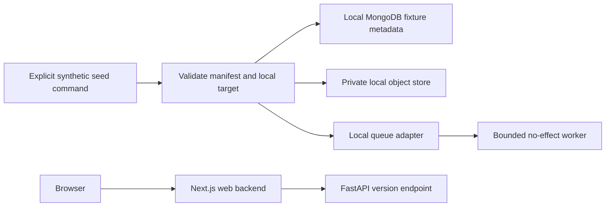

# P01 backend implementation plan — repository and developer foundation

**Status:** P01 technical development plan, revised 9 November 2026. Technical selections identified as proposals remain unresolved until validated and recorded.

Read with the [web plan](../web-implementation/p01-repository-and-developer-foundation.md), [P01 detailed criteria](../../Phases/P01-repository-and-developer-foundation.md), [roadmap](../../ROADMAP.md), [status](../../PROJECT_STATUS.md), [Jira workflow](../JIRA_WORKFLOW.md), [development integration](../GITHUB_JIRA_INTEGRATION.md) and accepted Decisions [0001](../decisions/0001-release-1-scope.md), [0002](../decisions/0002-architecture-baseline.md), [0003](../decisions/0003-jira-owned-development-validation.md). The [specification](../shipsense-full-product-specification.pdf) is product source material; recorded decisions define the implementation baseline.

## Tested foundation and remaining dependency gates

P01.1/SCRUM-13 and P01.2/SCRUM-14 are accepted and merged on 9 November 2026: [foundation proof](https://spjyotiranjan.atlassian.net/browse/SCRUM-13?focusedCommentId=10003), [quality proof](https://spjyotiranjan.atlassian.net/browse/SCRUM-14), [PR #4](https://github.com/spjyotiranjan/shipsense/pull/4), and [PR #5](https://github.com/spjyotiranjan/shipsense/pull/5). Main baseline is `7749e4de360372f6d99f6b468c8fcbf22f7a4947`. Reuse accepted foundation/quality proof; neither acceptance nor merge completes P01.

Tested surfaces include the credential-free FastAPI `/foundation` route, generated canonical OpenAPI and TypeScript consumption, minimal web shell, frozen npm/uv workspaces and byte-level contract drift/quality checks. Version/liveness/readiness/error contracts, runtime response validation and diagnostic UI states below are remaining SCRUM-16 work, not existing behavior.

SCRUM-16 contract and web diagnostic implementation requires accepted SCRUM-13/14 surfaces, without waiting for SCRUM-15 storage/queue setup. First implement and verify canonical version/liveness/safe-error schemas and generated contracts without cloud credentials; then integrate the web against that tested contract. Schema generation, version and liveness must remain independent of storage, queue and database availability. Readiness schema/error examples and bounded probe interfaces can be defined now, but full SCRUM-16 acceptance requires SCRUM-15's real local adapters, seeded dependencies and outage/recovery proof. Stubs or mocked readiness cannot satisfy that gate.

SCRUM-15 still requires validated issuer/emulator/reference-service selections and its fixture/region/tier/cost proof. SCRUM-17 full clean-checkout build/unit/contract/smoke CI depends on completed SCRUM-15/16 integration. Full readiness and P01 exit retain every positive, negative and recovery criterion; this dependency split waives none.

Accepted tooling is recorded in Decisions [0005](../decisions/0005-initial-foundation-toolchain.md) and [0006](../decisions/0006-local-quality-toolchain.md). Preserve the current pins and frozen locks; select only still-missing tools with compatibility proof. The development minimatch advisory remains a disclosed limitation: recorded triage found no reachable vulnerable path in the current lint configuration, not blanket risk acceptance. Starlette/httpx deprecation remains. Decision 0003's 100-commit ceiling and unverified PR creation/title-edit/new-push lifecycle remain unproven; do not treat that status as a required merge gate until verified. OpenAI model selection remains advisory until measured P12 evaluation; no model is selected by this plan.

## Prerequisites, release order and scope

P00 architecture decisions are the prerequisite. Accepted P01.1/SCRUM-13 → P01.2/SCRUM-14 supply tested surfaces for both P01.3/SCRUM-15 and the credential-free P01.4/SCRUM-16 contract/web slice. SCRUM-16 web integration follows its tested canonical contract; full SCRUM-16 readiness/outage/recovery acceptance requires SCRUM-15. P01.5/SCRUM-17 full integration CI follows both completed slices. A folder or closed ticket alone is insufficient proof.

Python FastAPI is the main backend, owning canonical APIs, authorization, policy, integrations and action orchestration. Next.js API routes form the web-facing backend layer and call FastAPI for canonical domain behavior. Python workers/jobs handle asynchronous processing.

P01 establishes reproducible boundaries and synthetic diagnostics. P02 owns login, tenant authorization and durable application audit; P03 owns canonical event/evidence persistence and retention classes. P05/P06 own live connectors. Do not add live provider ingestion or production actions to make the foundation demo look complete. Preserve the selected Next.js/FastAPI/MongoDB/R2/Azure stack.

## Repository and toolchain proposal

| Required boundary | Technical contents | P01.1 acceptance proof |
| --- | --- | --- |
| `apps/web` | buildable Next.js/TypeScript shell and web-facing backend | Minimal build and README commands |
| `services/api` | FastAPI package; settings, routes, schemas, safe errors and tests | Import/build and minimal process startup |
| `services/worker` | Python worker entrypoint and local adapter boundary | Build/import and bounded no-effect smoke; no provider credentials |
| `packages/contracts` | API-generated OpenAPI, client/schema output and regeneration instructions | Deterministic minimal schema/client generation and consumption |
| `infra` | local service definitions and example config; future Azure modules clearly separated | Local config validates; no cloud apply command in boot |
| `docs` | Package responsibility READMEs, developer guide, plans/decisions and proof index | New contributor can follow without private explanation |
| `tests/fixtures` | synthetic manifest and named cases | Schema validation and explicit missing-fixture failure |

Proposed API layout: `src/shipsense_api/{main,settings,errors}.py`, `routes/{health,version}.py`, `schemas/foundation.py`, plus `tests/`. Worker has a separate entrypoint and adapter module; no imports from Next.js. Avoid an invented large domain abstraction layer before P02/P03 need it. Shared Python utilities may be extracted only when a concrete shared contract warrants them.

Use the accepted npm/uv workspaces, one frozen lock per language, generated OpenAPI/TypeScript and pinned quality tools from Decisions 0005/0006. Their compatibility and seeded failure/recovery proof are accepted under SCRUM-13/14; preserve those pins. Still-missing runtime response validation, browser smoke tooling and emulators require explicit compatibility evidence before use. Do not add a second handwritten domain API, floating versions or duplicate locks. Document additions and regeneration commands without repeating accepted foundation work.

Keep `.env.example` synthetic and descriptive, local `.env` ignored, example values unusable as real credentials. Validate startup profile, required local settings, endpoint allowlists and bounds. Reject production profile combined with local identity/queue/storage adapters; errors name missing setting keys without their values. Azure deployment secrets later use Key Vault and managed identity. Provider secrets never enter MongoDB, fixtures, prompts, logs, browser bundles or R2.

Preserve `.githooks/pre-commit` and configure `core.hooksPath=.githooks`. The hook checks staged Markdown whitespace/newline. Jira owns remote branch/commit-key validation; retain its 100-commit ceiling and unverified creation/title-edit/push lifecycle gaps as explicit risks. Do not add duplicate GitHub Actions Jira validators or local issue-key hooks.

## Local services and synthetic fixture blueprint

Propose a documented Docker Compose local profile: MongoDB, a private S3-compatible development store for the R2 adapter, and a local queue adapter. Local storage is an emulator, not a decision to replace R2. An in-process queue is permitted only for local development by Decision 0002 and must disclose lack of durable/restart parity with Service Bus. Do not use it to claim production retry/dead-letter acceptance. Select and pin the exact storage emulator and any optional Service Bus emulator only after compatibility checks; no new cloud credential dependency.

Document ports, volumes, health checks, Windows prerequisites, startup order, stop and explicit synthetic-only reset. Bind development services to loopback; use isolated fixture DB/bucket names and reject reset against non-local/non-fixture targets. A reset must never enumerate/delete unrelated databases, accounts or objects. Seed is an explicit developer command, never an automatic production startup side effect. Restrict object access; prove anonymous reads fail even locally.



Proposed fixture schema, separate from future canonical domain schemas:

```typescript
type FixtureManifest = {
  schemaVersion: "p01-fixture-v1";
  fixtureId: string; tenantId: string; projectId: string;
  serviceId: string; environment: "local";
  provider: "synthetic"; providerObjectId: string; providerVersion: string;
  eventTime: string; observedAt: string; expiresAt: string;
  freshness: "fresh" | "stale" | "missing";
  sourceRef: string; classification: "synthetic";
  payloadSha256: string; expectedOutcome: string;
};
```

Timestamps are UTC RFC3339; IDs are bounded opaque strings; checksum is 64 lowercase hex characters. Validate size, field bounds, sourceRef as a local fixture reference and checksum before seed. No production URLs, real logs, credentials or personal data. Missing evidence is explicit, not replaced with fabricated success. Fixture objects and metadata share the full local scope and correlation ID. Use scoped deterministic IDs and idempotent upserts; same fixture/version/checksum is a no-op, conflicting checksum for the same version fails and preserves prior evidence. Unique compound key proposal: `(tenantId, projectId, serviceId, environment, fixtureId, providerVersion)`. Do not create a global seed key that collapses tenants.

Seed may be interrupted between object and metadata writes: write checksum-addressed immutable local objects first, then upsert verified metadata; retry completes safely. Record partial failure without overwriting a prior successful version. Document cleanup of expired orphan fixture objects under a checked local prefix. Worker accepts only local synthetic envelopes, uses stable delivery IDs, and records bounded diagnostic attempts. Duplicate/reordered cases exercise the local adapter's declared behavior; durable Service Bus guarantees remain future integration proof. No external API call or effect may occur from these cases.

Decision 0001 fixes Astronomy Shop as the reference application but requires one primary service and named fixtures in P01. Proposal: evaluate a small request-path service, pin its upstream revision and reproducible local inputs, and record the exact service choice with validation evidence; this plan does not select one. Required named cases: `pipeline-failure`, `probe-config-regression`, `missing-telemetry`, `dependency-failure`, `injected-runbook`, `deployment-regression`. Each needs a manifest, expected failure/abstention or outcome, provenance and freshness. Synthetic content models these cases; it does not prove live Azure/Vercel behavior. Treat injected-runbook content as inert untrusted text; no AI tool execution in P01.

## API contract proposal

FastAPI OpenAPI is canonical. Generate a committed versioned schema and typed/runtime-validated web client in `packages/contracts`; document Swagger at `/docs` and schema at `/openapi.json` for the local profile. Deployment exposure of operational docs is a separate secured configuration decision. Do not maintain a parallel handwritten TypeScript domain API. Contract generation should not require cloud connections or expose environment values.

| Method/path | Result | Access and dependency boundary |
| --- | --- | --- |
| `GET /health/live` | 200 `{"status":"alive"}` | Minimal process liveness; never probes dependencies |
| `GET /health/ready` | 200 `{"status":"ready"}` or 503 typed `DEPENDENCY_UNAVAILABLE` | Internal/local operator route; bounded local dependency checks, no provider data or credential detail |
| `GET /api/v1/version` | 200 VersionResponse | Deliberately minimal diagnostic; no authentication bypass to domain data |

Proposed canonical types:

```typescript
type VersionResponse = {
  service: "shipsense-api";
  version: string;        // bounded release identifier, not arbitrary env data
  apiVersion: "v1";
  observedAt: string;     // RFC3339 UTC, generated per request
};
type ApiError = {
  error: {
    code: "DEPENDENCY_UNAVAILABLE" | "INVALID_REQUEST" | "INTERNAL_ERROR";
    message: string;     // bounded safe public text
    requestId: string;   // bounded opaque correlation
    retryable: boolean;
  };
};
```

Example `/api/v1/version` success:

```json
{"service":"shipsense-api","version":"0.1.0-dev","apiVersion":"v1","observedAt":"2026-11-08T00:00:00Z"}
```

Example readiness failure:

```json
{"error":{"code":"DEPENDENCY_UNAVAILABLE","message":"A required dependency is unavailable.","requestId":"req-local-001","retryable":true}}
```

Pydantic response models must constrain fields and produce matching OpenAPI success/error examples, including the custom safe 422 validation envelope and safe 500 response. Never echo rejected values, dependency URLs, DSNs or stack traces. Propagate a validated bounded correlation identifier or generate one; include it in response headers and sanitized logs. The web backend adds only transport errors (502 `API_UNAVAILABLE`/`UPSTREAM_CONTRACT_INVALID`, 504 `API_TIMEOUT`) using the same envelope, as described in the web plan; these are not FastAPI domain errors. Verify Swagger examples against runtime responses and generated client validation.

Version and liveness are independent of database/queue/storage availability. Readiness checks have bounded connection deadlines and an overall deadline (proposal: 1 second per dependency within 3 seconds total), returning only generic unavailable information externally and sanitized dependency names internally. Use connection pools and explicit shutdown cleanup. Do not perform blocking client work on the async request loop. Avoid shared mutable cached readiness state or checks that pile up under concurrent probes; cap concurrency and test concurrent readiness while a dependency is down. Diagnostic responses use `Cache-Control: no-store`.

No customer resource endpoint is introduced. Make unauthenticated diagnostic exceptions explicit rather than providing an allow-all permission middleware that later leaks into domain routes. Runtime profile must deny real provider actions and production startup with local adapters. Real user/provider authority must be resolved independently in FastAPI/workers before future scoped retrieval/effects. Synthetic scope fields are test metadata, not authenticated claims. P01 logs establish request/attempt correlation; they do not claim an immutable audit archive or completed P02 audit enforcement.

## Reproducible command and CI contract

Frozen installs, contracts:generate/contracts:check, quality, test:foundation and build:web already exist in the accepted foundation; reuse their documented commands. The table describes the full target behavior, including commands still to implement for SCRUM-15–17. Prefer cross-platform root wrappers (Node/Python/package scripts) over requiring Bash on Windows. Document exact prerequisites, frozen install commands, ports, commands, expected output, teardown and troubleshooting in the first working change. Reconcile names with the web plan before implementing.

| Target | Required behavior |
| --- | --- |
| `bootstrap` | Verify pinned runtimes and install frozen web/API/worker dependencies without cloud secrets |
| `local:up` / `local:down` | Start/stop only named local services; report readiness; preserve volumes by default |
| `fixtures:seed` | Validate and seed scoped synthetic fixtures idempotently, refusing unsafe targets |
| `dev` | Start API, bounded local worker and web with explicit local profile |
| `contracts:generate` / `contracts:check` | Generate canonical schema/client; fail on drift without cloud boot |
| `check` | Format-check, lint, typing and secret scan for all affected packages plus Markdown checks |
| `test:unit` | API, worker, contract adapter and web meaningful unit checks |
| `build` | Build Next.js and API/worker distributions or images under pinned tools |
| `test:smoke` | Start actual built web/API against seeded local dependencies; assert success/failure/recovery |

P01.2 established scripts, check targets and the minimal quality workflow with seeded CI failure/recovery proof. Reuse that accepted work; expand CI to builds/services/contracts/unit/smoke in SCRUM-17. This is a planned dependency resolution, not a waiver of P01.2 acceptance. Workflow checks are distinct from Jira-owned key validation.

CI uses a clean checkout and the same command targets, pinned runtimes/locks/images and local adapters as the primary checkout. Run frozen installs, code/schema generation drift, quality/security checks, unit tests, both application builds, startup, seeded integration and browser smoke. Capture sanitized failure artifacts with bounded retention; tear down CI services on failure. Restrict workflow permissions, pin third-party actions, and give untrusted PRs no cloud/provider secrets or write authority. No paid provisioning or deployment stage belongs to this foundation CI.

## Acceptance and meaningful failure proof

| Subphase | Positive proof | Required negative/recovery proof |
| --- | --- | --- |
| P01.1 / SCRUM-13 | All seven boundaries exist with package responsibility READMEs/commands and minimal buildable packages; another contributor follows README | Missing required config/fixture yields actionable safe failure; no private setup knowledge |
| P01.2 / SCRUM-14 | Exact tools and locks committed; all language/Markdown/secret targets pass locally and minimal CI | Independent synthetic format/lint/type/secret violations cause corresponding local and CI failure; wrong/floating tool setup rejected; remove probes and recheck |
| P01.3 / SCRUM-15 | Fresh local profile starts dependencies and seeds repeatably with all cloud credentials absent | Repeat seed unchanged; cross-scope/collision/invalid checksum/missing fixture/unsafe reset refused; dependency outage and partial seed retry; private object denies anonymous read |
| P01.4 / SCRUM-16 | Real browser → Next.js → versioned FastAPI response; OpenAPI/Swagger/client agree, including error example | API stop/timeout/schema mismatch and recovery; readiness 503 while liveness stays 200; safe errors/logs; keyboard and responsive states |
| P01.5 / SCRUM-17 | Clean CI builds both apps and repeats documented contract/unit/smoke checks | Contract drift and failed upstream break CI; no hidden cloud credential or workstation service reliance; teardown after failure |

Plan test scope before each change: shared contracts/toolchain/config/security/local storage require cross-surface integration checks. Evidence identifies the tested revision or exact diff, profile, dependency availability, commands, exit codes, test counts, observed behavior, artifacts and unverified criteria. A fresh-profile local reproduction plus clean CI proves repeatability.

Secret-scan probes are unmistakably synthetic fixtures in temporary checked locations, never real credentials; document expected scanner detection. Failure tests restore the tested service/config and prove recovery. Do not delete a user's existing data for a clean boot. Capture versioned schema, UI screenshots and request correlation with sanitized logs. Local builds and direct behavior checks must pass; CI success alone cannot substitute for local proof.

## Outstanding selections and paid-resource gate

| Gate or proposal | Validation evidence required | Release impact |
| --- | --- | --- |
| Local OIDC issuer | Evaluate a pinned local issuer with discovery/JWKS, test users, key rotation, isolation and credential-free boot; document API contract impact and the selected configuration | Resolve in P01 before exit; full login/permission enforcement remains P02. Do not invent an issuer now |
| Astronomy Shop primary service | Record exact service/upstream revision, bounded fixture inputs and six named manifests | Resolve in P01; no broad reference stack/cloud deployment required to fake readiness |
| Exact toolchain/emulators | Record compatibility, pins, local/CI parity and known emulator gaps | Accept before related implementation; production claims require real service tests later |
| Central India feasibility/residency | Validate service and Atlas availability/tier/connectivity, backup/restore suitability, pilot residency, latency to R2/Vercel and dated authoritative evidence | Provisional region is not a residency commitment; change requires recorded accepted decision |
| Forecast, tiers and spend | Produce an itemized Azure web/API/workers/jobs, Service Bus, Key Vault, telemetry, Atlas, R2, Vercel and OpenAI forecast with usage assumptions for 20–30 active users, currency/date/taxes, idle/load estimates, quotas, budget alerts, teardown and ownership | No invented monetary ceiling. Owner approval of actual recurring spend precedes paid provisioning; no resource creation in P01 plans |

Region/cost validation belongs to P01 exit even though it is not a sixth Jira subphase: attach selection/forecast evidence under SCRUM-15 and link the phase review. Exact prices/service availability are not researched or asserted by this plan. Use current authoritative sources during that validation; if cost assumptions or residency remain unresolved, report the gap instead of marking the phase complete. Local foundation development does not require paid-resource approval; actual provisioning does.

## Phase exit proof

Phase exit requires all five subphases' positive and negative proof, credential-free boot by documented commands, a real web-to-API request, canonical Swagger/error examples, matching clean CI, selected issuer/reference fixtures, region/tier/cost validation, permission/secret boundaries, accessible degraded states and traceable diagnostics. Record review date, evidence, open risks and follow-on work in the P01 phase review and status, plus Jira links. Keep incomplete items visible; merge/build success and ticket closure alone do not complete the phase. P02 depends on this complete P01 exit record.
