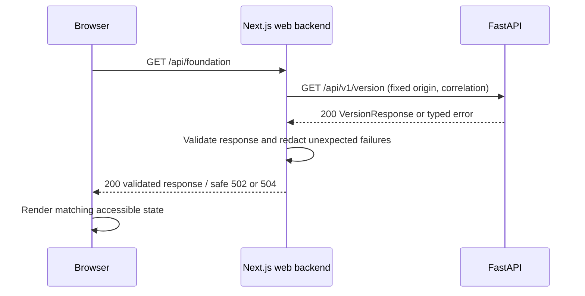

# P01 web implementation plan — repository and developer foundation

**Status:** P01 technical development plan, revised 8 November 2026. Technical selections identified as proposals remain unresolved until validated and recorded.

Read with the [backend plan](../backend-implementation/p01-repository-and-developer-foundation.md), [P01 acceptance criteria](../../Phases/P01-repository-and-developer-foundation.md), [roadmap](../../ROADMAP.md), [status](../../PROJECT_STATUS.md), and accepted Decisions [0001](../decisions/0001-release-1-scope.md), [0002](../decisions/0002-architecture-baseline.md), [0003](../decisions/0003-jira-owned-development-validation.md). The product source remains [the specification](../shipsense-full-product-specification.pdf); accepted decisions define the architecture baseline.

## Subphase dependencies

P00 architecture decisions are the prerequisite. Implement the smallest dependency first; each row requires the preceding subphase's technical proof.

| Order | Subphase | Deliverable and dependency proof |
| --- | --- | --- |
| 1 | P01.1 / SCRUM-13 | Seven repository boundaries, package responsibility READMEs and repeatable minimal builds |
| 2 | P01.2 / SCRUM-14 | Pinned toolchains, frozen locks, format/lint/type/secret checks with seeded local and CI failures |
| 3 | P01.3 / SCRUM-15 | Credential-free local services, scoped synthetic fixtures, idempotent seed and dependency failure proof |
| 4 | P01.4 / SCRUM-16 | Canonical FastAPI contract followed by web integration; real success/error/recovery journey |
| 5 | P01.5 / SCRUM-17 | Clean CI repeats local contract/unit/smoke checks and builds both applications |

## Web boundary and tooling proposal

Keep a simple, consistent functional UI; the user deferred a full redesign until broad product coverage. Use Next.js and strict TypeScript. Python FastAPI is the main backend. Next.js API routes are the web-facing backend layer and call FastAPI for canonical domain behavior.

| Path | Responsibility |
| --- | --- |
| `apps/web/src/app/page.tsx` | Foundation diagnostic shell; initial loading and completed/error states |
| `apps/web/src/app/api/foundation/route.ts` | Same-origin web-facing backend; fixed upstream API destination, bounded request and safe error mapping |
| `apps/web/src/components/foundation-status.tsx` | Presentational status/retry component; no provider logic |
| `apps/web/src/lib/server/api-client.ts` | Server-only typed FastAPI client and runtime response validation |
| `apps/web/tests/` | State rendering and browser smoke checks |
| `packages/contracts/` | FastAPI-generated OpenAPI, typed client/schema artifacts and generation instructions |
| `docs/` | Boot, developer commands, technical plans and evidence links |

No MongoDB, R2, queue, provider SDK or domain authorization implementation in the browser or web layer. FastAPI owns canonical APIs. Browser-visible configuration is limited to intentionally public values; upstream origins and any future session credentials remain server-only. Do not add arbitrary URL proxying, user-controlled upstream headers or fetch destinations.

Propose a single JavaScript package manager with a committed lockfile, Node/tool version pins, TypeScript strict mode, formatting/linting, a schema-based generated client and browser smoke runner. Select exact mutually compatible supported versions during P01.2 and record compatibility evidence and consequential technical choices before use. Avoid unpinned `latest`, multiple package-manager locks and a second handwritten domain contract. Backend tooling proposals are in the paired plan. No exact current release/version compatibility has been validated by this document.

## First vertical slice and interface

The first screen reports ShipSense API reachability/version for local development. It does not display tenant/customer data, login, provider controls or deployment health. Keep the purpose visible: a reachable API says nothing about customer recovery. P02 supplies authenticated product surfaces later.

```text
ShipSense — developer foundation
Local development · synthetic data only

API connection: Checking… / Connected / Unavailable
API version: 0.1.0-dev (only after validated success)
Last checked: <local display of returned UTC time>
[Retry connection]
Request reference: <safe opaque correlation ID on failure>
```

Use semantic heading/main, text labels as well as icons/colors, readable contrast, visible keyboard focus, a button with an accessible name, and polite status announcements. Disable duplicate retries while in flight without trapping focus. On failure clear the current version field; if showing a previous result, label it explicitly as historical with its timestamp. Use the same compact layout on mobile and desktop. Loading, invalid/missing response, disconnected/timeout and recovered states require proof. A shell without scoped records does not need fake tenant selectors or fabricated denied-data counts.



The [backend plan](../backend-implementation/p01-repository-and-developer-foundation.md#api-contract-proposal) defines canonical schemas. Proposed success body, shared without a second domain shape:

```json
{"service":"shipsense-api","version":"0.1.0-dev","apiVersion":"v1","observedAt":"2026-11-08T00:00:00Z"}
```

Proposed safe web-backend error:

```json
{"error":{"code":"API_UNAVAILABLE","message":"The API is unavailable. Retry the connection.","requestId":"req-local-001","retryable":true}}
```

| Condition | Web backend result | UI behavior |
| --- | --- | --- |
| Valid canonical success | 200; `Cache-Control: no-store` | Show Connected, version and checked time |
| API network failure or invalid schema | 502 `API_UNAVAILABLE` or `UPSTREAM_CONTRACT_INVALID` | Clear current success; retry available; opaque request reference |
| Bounded upstream timeout | 504 `API_TIMEOUT` | Show timeout text; explicit retry, no endless spinner |
| Future 401/403 | Preserve safe auth semantics; never reinterpret as success | P02 login/denied state; no resource metadata in error |

Propose a 5-second upstream deadline and one explicit request per user attempt, with cancellation on unmount and no background retry loop. Validate returned strings, timestamps and size; do not render returned HTML. Treat response/log content as untrusted. Request references are bounded opaque identifiers, never credentials. Record request ID, route, status and elapsed time in safe structured server logs; exclude bodies, tokens and upstream error traces from browser responses.

Do not cache this diagnostic across users or environments. Cancel superseded requests or use attempt IDs so a slow failed request cannot overwrite newer success. No optimistic Connected state. Keep upstream connection pooling server-side with bounded timeouts; do not fetch MongoDB/R2/queue on every render. A single version request proves the required web-to-API path. Readiness remains a separate operator check. If later scoped reads are introduced, require API-side effective permission resolution first, and include authorized scope/version/freshness in cache design before enabling caching.

## Local and CI verification plan

The change surface includes Next.js runtime, server fetch, canonical schema artifacts, UI state and shared toolchain. Runtime integration and contract changes need more than a compile. Use only the primary checkout. The backend plan defines proposed common command targets; implement and document those exact commands or revise both plans together before work depends on them.

1. Record the tested revision, config profile, tool versions and dependency availability. No cloud credentials or real tenant data may be needed.
2. Frozen install and generated-contract drift check; format/lint/type/unit checks and production Next.js build. Configure the existing Markdown hook with `core.hooksPath=.githooks`. Test files and commands remain understandable from READMEs.
3. Boot local dependencies and FastAPI; start the built web app. Browser smoke must observe a real Next.js-to-FastAPI response and match `/api/v1/version` to displayed version. A mocked response alone cannot pass.
4. Stop the API, retry and observe a safe unavailable state; inject delayed/malformed responses through a local test harness to verify timeout/schema errors and stale-attempt suppression. Restart API and prove recovery. Check logs/browser for secret or stack-trace leakage.
5. Run keyboard navigation and inspect loading/success/error at narrow and wide viewports; capture screenshots with expected/observed result. Component tests can deterministically cover loading and cancellation races.
6. P01.5 CI uses the same targets, pinned tools and synthetic services; installs/builds both apps from a clean checkout, then runs real browser smoke. Make API failure cause smoke to fail. Publish sanitized logs and screenshots under bounded artifact retention.

For SCRUM-14, seed format, lint, type and synthetic-secret violations independently in disposable test inputs; each must make its local check and CI check fail, then pass after removal. Never commit a real secret or a deliberately broken product. Jira owns remote development-key checks under Decision 0003; do not resurrect removed local key hooks or duplicate Actions validators. Its documented lifecycle gaps remain explicit acceptance risks, not assumed green checks.

## Phase exit proof

Attach reproducible proof for each subphase: commands with exit codes, tested revision and configuration, generated API artifact, direct behavior results, screenshots where applicable, failure/recovery proof and remaining gaps. All five subphase criteria must pass. The final phase record includes review date, evidence links, unresolved risks and an explicit technical verdict. P02 depends on this complete P01 exit proof.

## Outstanding technical selections

- Local OIDC issuer and the pinned Astronomy Shop service/revision/fixtures are not yet selected; the backend plan defines evaluation criteria. Resolve them in P01 without claiming P02 authentication is complete.
- Region, Atlas tier, residency, latency, monthly forecast, quota/alert values and recurring-spend approval remain gates before paid provisioning. The diagnostic UI needs no cloud credentials.
- Exact tooling versions, generated-client method and proposed diagnostic/error contracts require compatibility and contract validation before dependent code. API health data remains separate from customer health claims.
- Keep the UI simple and consistent. Verify concrete accessibility and usability uncertainties in the diagnostic journey.
