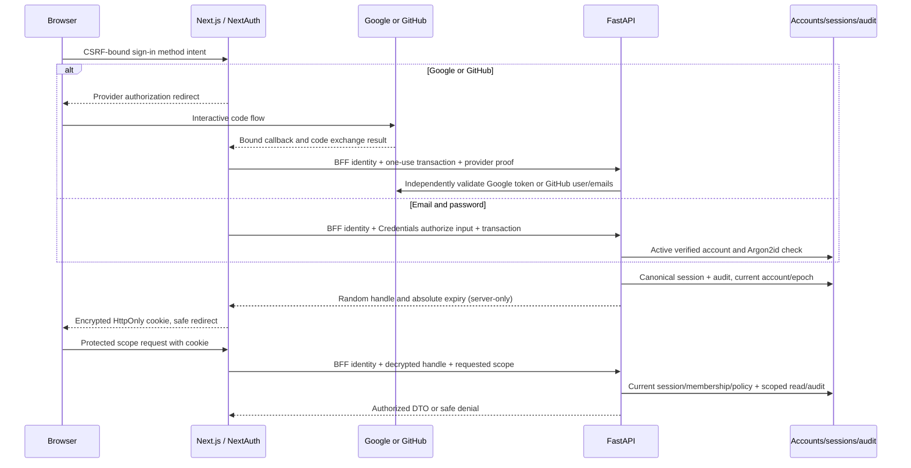

# P02 web implementation plan — identity, tenancy, permissions and audit

**Status:** Revised proposal for renewed phase audit, 11 November 2026. No implementation or checkpoint completion is claimed. Include the accepted plan in the first working implementation change, alongside the [canonical backend plan](../backend-implementation/p02-identity-tenancy-permissions-and-audit.md).

## Scope, baseline and dependencies

Cover all five [P02 checkpoints](../../Phases/P02-identity-tenancy-permissions-and-audit.md) using the simple consistent UI required by [Decision 0004](../decisions/0004-phase-planning-and-delivery-standards.md). Preserve Next.js/TypeScript, its web-facing backend, FastAPI's canonical authorization/policy/domain API, generated contracts and hosted-only server configuration under Decisions [0002](../decisions/0002-architecture-baseline.md), [0005](../decisions/0005-initial-foundation-toolchain.md), [0006](../decisions/0006-local-quality-toolchain.md), [0007](../decisions/0007-local-foundation-dependencies.md), [0008](../decisions/0008-checkpoint-development-workflow.md) and [0009](../decisions/0009-p02-sign-in-methods.md). [Project status](../../PROJECT_STATUS.md) supplies prerequisite truth. Specification pages 9–11 supply role and approval intent; broad enterprise administration is outside this release slice.

P01 currently has a public foundation page and same-origin `/api/foundation` adapter. Keep those credential-free diagnostics safe and available during identity failure. There is no authenticated shell, tenant selector, admin UI or approval timeline. Do not stretch the diagnostic transport into a domain session bypass. Add bounded authenticated transport beside it and retain its timeout, cancellation, schema validation, redirect refusal, safe-error and request-correlation behavior.

Backend group A establishes entity/scope/role/audit contracts; B establishes NextAuth/provider/password authentication and scoped access; C adds policy/approval and audit completion. Web schema consumption and inert component work can follow A, while usable administration and protected pages depend on B. Approval UI depends on C's exact version/eligibility contracts. Share related checkpoints in those combined changes where reviewable; retain proof independently for P02.1–P02.5. Do not create a separate planning PR or an unprotected temporary admin route. Owner phase go-ahead and accepted provider/library/session choices precede dependent implementation.

## Technical layout and data flow

Proposed directories: authenticated App Router pages under `apps/web/src/app/(authenticated)/`; NextAuth handlers under `app/api/auth/[...nextauth]/` and auth pages under `app/auth/`; same-origin resource handlers under `app/api/`; server-only NextAuth/session and canonical API adapters under `src/lib/server/`; scoped functional components under `src/components/`. Consume `packages/contracts` generated FastAPI schemas and validate unknown responses at runtime. Do not introduce a handwritten domain type system in route handlers.



NextAuth orchestrates login, while FastAPI remains the canonical identity/session/authorization boundary. A valid cookie does not authorize a domain request independently. No browser-visible session DTO contains the canonical handle, provider tokens or role claims. Provider login scope is separate from connector permissions. Direct human bearer routes are unavailable initially; a Google ID token or GitHub access token is not a ShipSense domain bearer. Password verification and account lifecycle run in FastAPI, not a second Next.js domain implementation. Browser code never receives signing/encryption keys, provider credentials or MongoDB/R2 settings; domain responses are authorized even for server components and prefetches.

## Login, session and trust contracts - P02.2

Configure NextAuth Google, GitHub and Credentials providers under the pinned release's standard handlers; custom pages are `/auth/sign-in`, `/auth/register`, `/auth/check-email`, `/auth/verify-email`, `/auth/forgot-password`, `/auth/reset-password` and authenticated `/account/sign-in-methods`. Exact generated callback/CSRF endpoint paths must match that release. `GET /api/session` is a safe application DTO; protect the library session endpoint from handle serialization too. Fixed same-origin form adapters call the canonical auth contracts in the backend plan. Do not implement a second custom OAuth callback alongside NextAuth.

The [NextAuth Credentials documentation](https://next-auth.js.org/providers/credentials) requires JWT sessions for v4; the [current Auth.js guide](https://authjs.dev/getting-started/authentication/credentials) leaves password lifecycle to the application. Proposed bridge uses JWT strategy without a default database adapter: NextAuth's encrypted cookie carries only the canonical handle/reference and bounded expiry. FastAPI stores its hash and validates current state on every protected request. Never return the handle in `session` callbacks or browser JSON. Prove exact release compatibility, encryption/callback behavior and logout before depending on the bridge. No handwritten JWT cryptography or unapproved library substitution.

Use a host-only `__Host-` session cookie (proposed name `__Host-shipsense-session`) with `HttpOnly`, `Secure`, `SameSite=Lax`, `Path=/`, no `Domain`; validate library chunking/clearing behavior. Cap both cookie and canonical session to the proposed 15-minute absolute, ten-minute idle limits, without rolling extension. Rotate on authentication and account-method changes. Use loopback HTTPS; any HTTP exception needs explicit acceptance, separate development cookie/config and non-loopback refusal.

Provider initiation requires a server-bound CSRF transaction, one-use state and provider-supported PKCE/nonce bound to exact callback/client/purpose/internal return path. Reject callback replay, duplicate/ambiguous parameters, mix-up and arbitrary redirects. Fixed provider/API origins come only from validated server config, never forwarded host headers or token URLs. Refuse arbitrary URL proxying/upstream redirects and caller-supplied identity/role headers. No callback query/code/body logging or third-party content; no-store and no-referrer on all auth pages. Mutations require exact allowed Origin, CSRF bound to session/transaction, bounded typed body and content type; SameSite is insufficient. GET/prefetch never activates accounts, consumes tokens or changes methods.

Logout revokes canonical state before cookie clearing and removes protected UI from all tabs. If storage is unavailable, clear browser state but state server revocation is unconfirmed and deny protected reads; retry safely. Local logout does not claim provider-global logout. Canonical reset/deprovisioning invalidates session epochs. External Google/GitHub revocation lacks the old uniform introspection assumption: provider-specific detection/maximum lag remains an acceptance gate in the backend plan. On identity-service outage show unavailable, never stale privileged content. Public foundation diagnostics remain safe and available.

## Registration and sign-in wireframes

```text
Sign in to ShipSense
  [Continue with Google] [Continue with GitHub]
  Or use email and password
  Email [                         ]
  Password [                      ] [Show password]
  [Sign in]  [Forgot password?]  [Create account]
  Failure: Unable to sign in. Check your details or use a sign-in method
           you previously connected, such as Google or GitHub.

Create account
  [Continue with Google] [Continue with GitHub]
  Full name [                     ]
  Email [                         ]
  Password [                      ] [Show password]
  Password guidance / [Create account] / [Back to sign in]

Check your email
  If this address is eligible, instructions will arrive shortly.
  [Resend when cooldown ends] [Use another address] [Back to sign in]
  Sending unavailable: safe retry and request reference

Confirm email (GET does not activate)
  Re-enter registration password [             ] [Verify email]
  Expired/used/wrong-browser: request a fresh link or restart signup
  Verified: [Continue to sign in] (no automatic login)

Account > Sign-in methods (authenticated, canonical data only)
  Google / GitHub / Email and password: connected or available
  [Add method] -> reauthenticate existing method -> target proof
               -> confirm exact method -> result/session rotation
  [Remove] -> verify retained method -> confirm; last method refused
```

Full name, email and password are required for email registration; other profile fields are deferred. Use native `autocomplete=name`, `username`, `current-password` and `new-password` appropriately, password-manager/paste support, labeled visibility toggle and accessible field errors. Password is never placed in URLs, local/session storage, telemetry or error reports; clear after submission/navigation. A social profile name may prefill display data; missing name prompts a bounded name-completion form without granting tenant access. Names/emails are escaped data.

The existing-Google/password attempt gets the same failure text and buttons as every failed password attempt. After successful Google login, account settings offer explicit Add password with recent existing-method proof and mailbox challenge. Do not reveal "this email uses Google" from anonymous lookup or NextAuth error URL. New same-email provider identities get no automatic account binding: sign in with the existing method, then explicitly link. Keep `allowDangerousEmailAccountLinking` false/absent and test authenticated `signIn` cannot implicitly attach a provider. New signups get no tenant access until explicit membership/bootstrap rules are accepted.

For Google, require real verified-email evidence; non-authoritative third-party email needs an application challenge bound to the provider transaction. For GitHub private/missing/unverified email, explain the need for a verified primary email and retry without claiming the public profile proves it. These views display only facts from the user's current provider transaction, never another account's method set. Provider cancellation/denied consent, challenge expiry, API outage and mail failure are distinct safe retry states. Fixing an email never auto-merges accounts.

Forgot password always acknowledges generically. Reset links require browser binding, a new password and explicit POST; reset completes without login and revokes old sessions. Social-only accounts cannot use reset to create a password. Show universal provider guidance and safe provider-recovery links. Lost-all-method recovery, email changes and account merges are unavailable in P02 pending stronger accepted recovery design; no support-ticket override. Account management must reject stale reauth, mismatched provider/email and last-method removal.

The [Vercel account documentation](https://vercel.com/docs/accounts) provides a UX precedent for clearly separated login connections in authenticated account settings. [GitHub's authentication guidance](https://docs.github.com/en/authentication/keeping-your-account-and-data-secure/about-authentication-to-github) provides a precedent for explicit additional recovery methods. These inform navigation and explanation only: Vercel's passwordless email behavior and GitHub's account security are not adopted as ShipSense contracts. Keep the required password form and simple consistent UI; a broad redesign is deferred.

## Canonical API consumption and visible states

Keep a fixed mapping from same-origin web routes to FastAPI routes. The BFF authenticates its service identity and forwards only the current opaque handle, validated scope, method, bounded typed body, expected revision, idempotency key and safe correlation. FastAPI remains responsible for effective user/provider permission, policy and data filtering. Browser-selected IDs are requests, not authority. Response DTOs for each page must validate against the generated contract; a malformed upstream response fails closed without a partial privileged render.

| Surface | Canonical contract | Visible behavior |
| --- | --- | --- |
| Session shell | Current principal and tenant references from `/api/v1/me` | Signed out, resolving, active, expired/revoked, unavailable; no directory before membership |
| Scope selector | Tenant context with authorized project/service/environment references and authz revision | Explicit current scope; valid empty state; clear selection when grant disappears |
| Identity administration | Tenant-scoped entity/principal/team/grant routes with revision preconditions | Read view and permitted create/update/archive controls; owner/lifecycle and role scope visible |
| Permission panel | Safe capabilities and policy evaluation for a visible resource | Missing role, policy, step-up or provider authority explained only where disclosure is authorized |
| Proposal review | Exact proposal revision and evaluation/approval contracts | Candidate/version/digests, requirements, independent approver, expiry and invalidation states |
| Audit timeline | Scoped audit-events with bounded time/correlation and opaque cursor | Chronological material decisions, safe actor/version/reason and request/correlation references |

Provider authority displays `not connected`, `unknown`, `denied`, `stale` or `verified` with timestamp only when backed by a current adapter result. P02 has no live connector: show unavailable/not connected rather than inventing a provider grant. A synthetic demonstration is labeled as synthetic in the fixture view. Actual provider effects and export downloads remain unavailable. AI/copilot screens are not added in P02.

Use `401` to clear session and prompt sign-in; safe `403` for missing capability on an already visible resource; indistinguishable `404` for hidden/nonexistent resources; `409` to refresh a stale candidate/revision; `429` for bounded retry guidance; `503` for unavailable authority/storage. Render fixed safe text and request reference, not raw exception/validation payload. A network timeout must not imply that a mutation failed to commit: show outcome unknown, resolve by the same idempotency key/current resource before allowing a new attempt.

## Technical wireframes — P02.1, P02.3 and P02.5

Use existing typography and simple form/table components; support small viewports without hiding scope or approval reasons. These wireframes define data and behavior rather than a final visual redesign.

```text
Authenticated shell
  ShipSense                         Account / Sign out
  Organization [authorized choices] Project [choices]
  Service [choices]                  Environment [choices]
  Current access / last checked time / request reference
  Navigation: Scope | Access | Proposals | Audit
  [Loading / empty / unavailable / permitted page content]

Access
  Scope summary: organization → project → service/environment
  Tabs: Members | Teams | Services | Environments | Role grants
  Filter within this scope [input]       [Add, when permitted]
  Name | Principal type | Owner | Status | Role + scope | Version
  [Details] → lifecycle / grant scope / expiry / safe capabilities
  [Save] [Cancel] → pending → success OR conflict/denial/unknown

Audit
  Scope + bounded time range + correlation filter
  Time | Actor | Action | Outcome | Version | Correlation
  [Event detail] → safe reason / causation / policy / proposal
  [Next page] with opaque authorized cursor
  Archive export: unavailable until archive capability exists
```

An unauthorized user receives no object names, counts, navigation suggestions or autocompletion from hidden scopes. Do not show “three hidden projects,” include them in DOM attributes or embed them in server-rendered JSON. UI counts derive only from scoped API results. Audit visibility may be narrower than tenant membership. Keep team and environment selectors independent; selecting a service does not imply production access.

P02.1 administration uses only minimal tenant/project/team/service/environment identities; catalog graphs remain P04. A tenant administrator may manage delegable grants but cannot grant wider authority than allowed, remove the last administrator, silently reparent resources or gain operational privileges from the UI. FastAPI enforces these rules even if controls are bypassed.

## Policy and approval wireframe — P02.4

```text
Proposal [id] — exact revision [n] — environment [explicit]
  Action / target version / proposer / expiry
  Artifact + diff + config + dependency + verification digests
  Policy version / approval requirements / missing evidence
  Provider authority: unknown or backed current result
  Invalidation notice: [reason, when superseded/expired]
  [View permitted evidence] [Request fresh evaluation]
  Approval reason [bounded text]
  [Verify identity] → supported step-up → new eligibility check
  [Approve exact revision] [Reject] [Cancel]
  Timeline: proposal → decision → approval → synthetic attempt
```

The review page shows the exact bound versions before confirmation. Approve is available only with a fresh API eligibility result and matching independent human identity; disabled controls show safe reasons. FastAPI rechecks everything on submission. Step-up returns to the same proposal digest, rotates session authority and re-fetches current state; if the candidate changed, require review of the new revision. A countdown is informational; the server clock determines expiry. Do not automatically approve after step-up, silently substitute the latest candidate or reuse an approval across changed policy/configuration.

Generate one idempotency key per intended approval attempt and retain it across transport retries. Bind the key to that exact payload; changed intent creates a new key after current state is known. Disable duplicate submission while pending, but do not depend on button disabling for correctness. A conflict refreshes current versions and clears stale confirmation. Approval, provider dispatch and recovered health are separate states; the P02 UI shows only the approved/synthetic states it actually supports.

## Cache, concurrency and performance behavior

Authenticated pages, API adapters and responses use no-store/private handling; do not place session or tenant responses in shared Next.js/CDN caches. Do not use a module-global mutable current tenant, authorization decision or token. Request-local memoization is allowed only within the same principal/session/scope/revision. Any future persistent query cache must include all those dimensions and be invalidated on authority change; none is needed initially.

On scope change, logout, revocation or step-up, abort outstanding fetches, clear prior data and increment a request generation. Late results from older generations cannot populate the new screen. Synchronize logout between tabs with an event that contains no credentials; the server remains authoritative. Browser history/back, router prefetch and restored pages must revalidate session before showing protected data. Render no old tenant content behind a loading overlay.

Bound authenticated API calls with cancellation/deadlines and response-size limits; preserve existing transport behavior where suitable. Do not retry mutations automatically with new keys. Limit selector pagination and avoid N+1 capability requests: context should return scoped choices/capabilities in one bounded response. Measure initial authenticated render, provider login and canonical session-validation latency, permission evaluation and audit pagination at representative 20–30-user concurrency. Do not improve apparent performance by caching stale permission grants. An unavailable identity dependency is an explicit degraded state.

## Accessibility and failure behavior

Use labeled native controls, logical heading order, keyboard-operable tabs/selectors/tables and visible focus. Associate form errors with fields; announce loading/result/denial through appropriate live status without repeating secrets. Move focus deliberately after navigation/dialog completion and retain it on retry. Do not use color as the only indicator for production, denial, expiry or approval. Make the full scope and exact revision readable at narrow widths and zoom. Preserve public diagnostics and a safe signed-out explanation with JavaScript disabled; never embed protected content as a fallback.

## Verification and checkpoint evidence

These checks are planned. Documentation audit uses format/reference checks only; actual implementation must pass frozen installs, `npm run quality`, `npm run test:unit`, `npm run build`, `npm run contracts:check` and relevant existing API/web/browser smoke. Extend the maintained browser test path for authenticated flows rather than adding a separate hosted release system. Use isolated browser profiles outside the repository and stop only test-owned processes. Keep private settings out of PR CI and published artifacts.

| Checkpoint | Web and BFF evidence |
| --- | --- |
| P02.1 | Generated entity/role contracts; functional ownership/lifecycle/grant views; empty/error states; invalid ancestry and grant escalation shown safely; keyboard/narrow-viewport inspection |
| P02.2 | Real Google/GitHub and verified-password signup/login/logout/expiry/canonical revocation/deprovisioning; externally measured provider revocation behavior; secure cookie inspection without values; state/nonce/code replay, PKCE failure, wrong issuer/audience, session fixation, CSRF and malicious redirect tests; provider down/recovery; BFF service-plus-session boundary proof |
| P02.3 | Two-tenant/two-environment UI/API negatives; hidden/nonexistent response comparison; counts/autocomplete/DOM/serialized payload/log checks; rapid scope switches, prefetch/back/late responses and multi-tab revocation; direct API bypass of disabled UI still denied |
| P02.4 | Exact-revision review; independent approval and recent assurance; self/service-account/expired/changed-policy/changed-digest rejection; double-click, retry after lost response, concurrent change and stale-tab conflict; step-up failure/cancellation; zero provider effects |
| P02.5 | Authorized redacted audit reconstruction and correlation links across browser/BFF/API; pagination and filter tampering denied; storage outage withholds protected read/mutation result; archive-unavailable state; clear labels for simulated receipts and future capabilities |

For every checkpoint record delivered revision, configuration/provider profile, commands/results, meaningful negative cases, browser states and unverified criteria in the existing checkpoint record. Screenshots/logs are disposable evidence outside the product tree. Never count a skipped integration case as passed or mock a provider to claim real authentication. The backend no-effect callback/worker/tool harness proves shared guard behavior only; connector credentials/receipts arrive in P05–P07 and actual AI retrieval/checkpoints in P09. P02's phase exit still requires all checkpoint criteria and real applicable provider/email/session/persistence proof.

For P02.2, exercise the backend authentication negative matrix through actual forms and both session endpoints: required full name/email/password validation, password-manager and keyboard flow, known/unknown/social-only failure equivalence, provider cancellation/private or unverified email, verified-email confirmation without auto-login, expired/replayed/wrong-browser/scanner links, resend cooldown/generation, reset and delivery outage. Complete the Google-only → failed password → Google sign-in → explicit Add password journey; also verify password → explicit provider link, ordinary signed-in provider login cannot link, stale reauthentication, last-method removal races and safe lost-provider guidance. Inspect narrow viewport/zoom, focus/live announcements, browser back and multi-tab session revocation, plus no credential/handle in DOM, serialized session, logs, URL or cache. No simulated delivery proves real mailbox verification.

## Decision gates and reference basis

Research checked 11 November 2026. Accept exact NextAuth/Python libraries, session bridge/service credentials and lifetimes, loopback HTTPS, normalization/uniqueness policy, password/rate/token policy, recovery/unlink restrictions, SendGrid sender/region/authorized delivery and persistence boundaries, external provider revocation lag, role inheritance and supported step-up assurance before dependent implementation. [Decision 0009](../decisions/0009-p02-sign-in-methods.md) selects methods; it does not accept all these details. The backend plan contains authoritative schema/negative-test proposals and primary provider sources; UI states must agree with them. Neither document authorizes provisioning, product writes or spending.

[Google validation](https://developers.google.com/identity/gsi/web/guides/verify-google-id-token), [GitHub email API](https://docs.github.com/en/rest/users/emails), [NextAuth OAuth/linking](https://next-auth.js.org/configuration/providers/oauth), [SendGrid Mail Send](https://www.twilio.com/docs/sendgrid/api-reference/mail-send/mail-send), [OIDC Core](https://openid.net/specs/openid-connect-core-1_0.html) and [OAuth Security BCP](https://www.rfc-editor.org/rfc/rfc9700.html) support the trust distinctions above. Exact provider/client/library behavior still needs direct validation; no generic issuer introspection or MFA guarantee is inferred.
